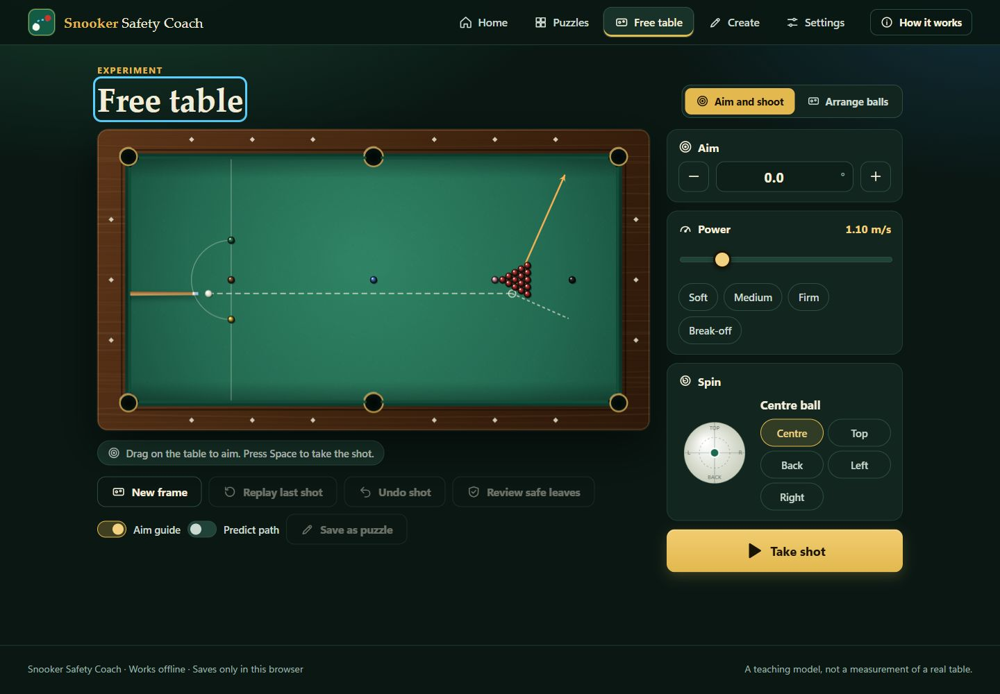

# Snooker Safety Coach

An offline, English-language web app that teaches snooker safety. Draw where the white ball will go, test the line on a physics table, and see what you left behind. Built with Canvas 2D and a shared custom physics engine. No backend, account, CDN, external font or installation.

## Run it

- **Open `dist/Snooker-Safety-Coach.html`.** The whole app is inside that one file. It works from disk (`file://`) with no network.
- To work on the source: open the project-root `index.html` with its neighbouring folders, or run `npm start` and visit `http://127.0.0.1:4173` (a static preview server, not a backend).
- `npm test` runs the Node built-in test suite (no `npm install` needed). `npm run build` recreates `dist/` and refreshes the puzzle catalogue, removing stale generated files.

Progress, settings and your own puzzles are kept in the browser's local storage. Opening the file from disk and from a web address use separate storage. If storage is blocked, a notice appears and practice still works.

## The screens

| Screen | What it is for | Main action |
|---|---|---|
| **Home** | See what the app does in seconds. An animated demo draws a route, plays it on the engine and shows the white hiding behind the brown. | Start or continue a puzzle |
| **Puzzles** | Browse 23 puzzles in five levels, filter by tactic, see progress. Each card previews the starting layout. | Open a puzzle |
| **Practice** | Draw the white ball's route on one puzzle. The table labels what to hit and what is in the way. | Check my safety |
| **Results** | Score, plain-language reasons, and a replay you can scrub, slow down and layer. | Next puzzle / Try again |
| **Free table** | Aim, set power and spin, shoot, rearrange the balls. | Take shot |
| **Create** | Turn a Free Table shot into a verified puzzle; import, export, remove and restore your puzzles. | Check and save puzzle |
| **Settings** | Table feel presets, physics fine-tuning, sound, labels, animation, replay speed, reset progress. | – |

Navigation is a top bar on wide screens and a bottom tab bar on phones. Your drawn route survives a trip to another screen and back. A how-it-works guide opens on the first visit and from the **How it works** button.

### Practice controls

- **Draw:** drag from the white ball. The line is simplified to a few numbered points and cushion contacts are detected for you. Tap **Start with a straight line** if you prefer to build the route point by point.
- **Adjust:** drag a point; tap the line to add one; select a point and choose **Remove point**. Points near a cushion snap onto it while you drag. **Undo**, **Redo** and **Clear route** are always visible.
- **Live feedback:** chips show the cushions your line takes and which ball it hits first. If it would hit the wrong ball, that ball pulses red.
- **Keyboard:** `Tab` steps through points; arrow keys move a point 1 mm (`Shift` for 5 mm); `Delete` removes it; `Ctrl+Z` / `Ctrl+Y` undo and redo; `Enter` checks.
- **Check my safety** shows live progress ("Shot 21 of up to 320") and can be cancelled. A cancelled or failed search never records an attempt and never claims a route is impossible.
- **Hint** reveals a broad landing area, not the answer.

### Results

**Final leave** jumps to the resting position and shows **Safe leaves**, computed from the selected shot's final layout. Mint marks the paper's low-exposure region (Eq. 37, threshold .30 from Eq. 38); purple marks positions hiding 95% or more of every legal red's contact directions. Toggle the map or switch replay source to compare. These are sampled geometric candidates, not guaranteed reachable finishes or scoring probabilities. The same review is available after a completed shot on the Free Table.

The score ring, a one-line coaching tip and the next action come first. Below: four meters with a plain sentence each (safety of the leave, finish spot, route shape, cushion contacts). The replay offers *Your shot* and *Reference shot*, play/pause, a scrubber with contact markers, 0.25×–2× speed, and layers for your route, the reference, the target area, ball trails and (for hiding puzzles) the **blocked view**: green directions where the red can still be hit, coral where it is hidden. A badge says whether the result was verified on the physics table, played as the closest legal shot, or only estimated.

### Free table

Free Table starts with 15 reds in a triangle, all six colours on their spots, and the white in the D. **New frame** restores this layout and resets power and spin. Drag on the table to aim. A cue stick, the ghost-ball contact point, the object ball's direction (orange) and the cue ball's stun deflection are drawn. The guide uses the same cushion openings and rounded jaws as the physics, and does not reflect off an imaginary wall across a pocket. **Predict path** previews the full route. `Space` takes the shot. **Arrange balls** adds, moves and removes balls or loads a preset layout. After a shot, **Save as puzzle** sends it to Create.

Power is cue speed, not the red ball's speed. The opening setting is 1.10 m/s; Soft, Medium, Firm and Break-off use 0.40, 0.80, 1.30 and 1.80 m/s. Higher speeds remain available on the slider. Rolling drag is now .014: the same .50 m/s rolling ball stops in about .91 m instead of 1.16 m. Existing custom cloth settings are preserved; the previous stock baseline upgrades automatically.

## Puzzle library

23 puzzles in five levels of increasing difficulty: Beginner, Foundation, Intermediate, Advanced, Challenge. Tactics: touch and control, hiding behind a colour, escaping with one to three cushions, moving the red to safety, and the break-off, including spin exercises. See [the catalogue](docs/puzzle-library.md). Every reference shot is produced by the shared physics engine and independently re-simulated by the tests: legal first contact, nothing potted, balls at rest, the advertised cushions in order, and the declared zones reached.

## Engine and scoring

The app combines a literature-informed physics engine with the paper's exposure proxy and the author's approved teaching extensions; the exact mapping is in [docs/paper-model.md](docs/paper-model.md), with external references in [docs/sources.md](docs/sources.md). A reference is a reproducible teaching shot, not a global optimum, and the geometric indicators are teaching measures, not probabilities.

### Scoring

Both routes are normalised to a start, cushion sequence, endpoint and 10 mm arc-length samples.

| Dimension | Definition |
|---|---|
| Endpoint E | `exp(−(endpoint error / R)²)`, using the simulated finish when a shot was found |
| Path P | `exp(−(discrete Fréchet distance / (0.08 × table diagonal))²)` |
| Cushions C | `0.25 exp(−count difference) + 0.35(1 − sequence edit distance / maximum count) + 0.40 × contact agreement` |
| Outcome O | Relative occlusion, separation, cue-ball zone, cushion proximity and object-ball safety, weighted by the puzzle's tactic |

**Total:** `100 × (0.45 O + 0.25 E + 0.20 P + 0.10 C)`.

- **Excellent:** E ≥ .90, P ≥ .85, C ≥ .80 and O ≥ .90.
- **Promising:** a substantially different path or cushion structure with E ≥ .90 or O ≥ .90, or an objectively better verified outcome with O ≥ .95.
- **Developing:** the next correction is always shown first. No failing label is used.

A verified, legal result whose safety is at least as good as the reference but whose route differs is also flagged **Alternative route recognised**. The reference is never the only accepted answer. Illegal first contact or potting prevents a high outcome score.

| Tactic | Occlusion | Separation | Cue zone | Cue cushion | Object safety |
|---|---:|---:|---:|---:|---:|
| Hide | .50 | .15 | .10 | .10 | .15 |
| Cushion | .05 | .30 | 0 | .45 | .20 |
| Escape | .10 | .40 | .15 | .10 | .25 |
| Distance | .05 | .50 | .10 | .10 | .25 |
| Move object ball | .05 | .20 | .05 | .10 | .60 |

### Matching a drawn line to a real shot

Submission runs a bounded, deterministic search over cue angle, speed and tip position, simulating each candidate on the standard table. It starts from the reference shot, aims at the first cushion point and the first stretch of your line, then refines locally. At most 320 candidates are simulated, the work yields to the page by elapsed time, and the user can cancel.

Three outcomes, always stated plainly:

1. **Verified** – a legal shot matches your line closely (endpoint ≤ 25 mm, mean path error ≤ 25 mm, maximum ≤ 80 mm, same cushion order). The score uses what really happened.
2. **Closest legal shot** – no strict match, but a legal shot with the same cushion order finishes within 6 cm of your drawing. It is played and scored on its real result, and the screen says so.
3. **Estimate** – nothing close was found. Scores use the drawn finish and are labelled as an unverified geometric estimate. This is never proof that a route is impossible.

### Physics and calibration

The playing area is 3569 × 1778 mm with 52.5 mm balls, a baulk line at 737 mm, D radius 292 mm and the black spot 324 mm from the top cushion. Mass 0.142 kg and nominal pocket openings are modelling approximations, not fixed rulebook values.

| Parameter | Default | Range |
|---|---:|---:|
| Sliding friction | 0.20 | 0.10–0.35 |
| Rolling resistance | 0.014 | 0.005–0.030 |
| Cushion energetic restitution | 0.98 | 0.50–1.00 |
| Cushion friction | 0.14 | 0–0.30 |
| Ball restitution | 0.94 | 0.85–1.00 |
| Side-spin decay | 8 rad/s² | 0–20 rad/s² |
| Cue speed | 1.10 m/s in Free Table | 0.10–6 m/s in the interface |
| Tip offset | Centre | combined radius ≤ 0.5R |

The standard table is a **teaching baseline**, not a calibration of a professional table. Sliding friction acts on contact slip, with an analytic sliding-to-rolling transition. The cushion model now uses a nose height of 1.4R, Coulomb friction at cushion and cloth, all three spin components, and compression/restitution work. The .98 value is energetic restitution, not 98% retained horizontal speed. See [the derivation, sources and regression checks](docs/cushion-model.md). Finite cushion openings, rounded jaws and throat capture replace the old circular pocket zones; see [pocket geometry and energy checks](docs/pockets-and-energy.md). Equal-mass ball collisions still apply normal restitution only. The outer step is 1 ms with swept collision and pocket events. The model omits jumps, masse, swerve, cloth nap, vertical pocket bounce, measured pocket templates and cushion deformation. Numerical consistency is not real-table validation.

## Source layout

| File | Role |
|---|---|
| `src/physics.js`, `geometry.js`, `scoring.js` | Engine, geometry (occlusion, cushions, aim preview) and assessment |
| `src/safe-leaves.js` | Review-only exposure grid and angular-occlusion teaching extension |
| `src/route-editor.js`, `replay.js`, `editor.js`, `courses.js`, `store.js` | Pure logic: route editing and undo, replay clock, puzzle authoring, course helpers, saved data |
| `src/renderer.js`, `audio.js` | Canvas drawing and synthesised sound |
| `src/ui.js`, `home.js`, `library.js`, `practice.js`, `results.js`, `freetable.js`, `creator.js`, `settings.js`, `guide.js`, `main.js` | Router, shared interface, and one file per screen |
| `data/puzzles.json` | Editable lesson data; `puzzles.js` is its offline mirror and `references.json` holds full reference trajectories |
| `scripts/generate-puzzles.js` | Reproducibly constructs and verifies every lesson (`node scripts/generate-puzzles.js` overwrites the built-in data) |
| `scripts/build.js`, `serve.js` | Clean offline build and local preview server |
| `tests/` | 174 tests: physics, geometry, scoring, lessons, editing, replay, storage, a scripted run through the main journey, and English-only checks |

More: [design notes](docs/design.md) · [verification](docs/verification.md) · [staged delivery](docs/stages.md) · [designer brief](DESIGN_BRIEF.md) · [changelog](CHANGELOG.md).

Research scratch files and a preserved earlier-language archive may exist locally under the git-ignored `tmp/` and `archive/` folders. They are not part of the release.
