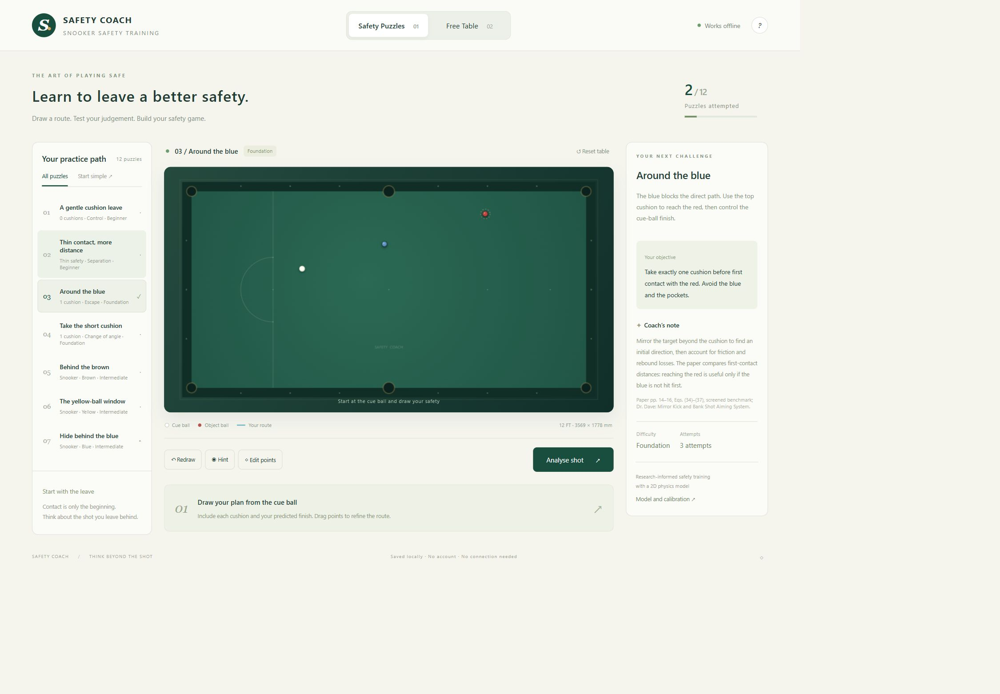

# Snooker Safety Coach

An offline, English-language web game for learning snooker safety. Draw a proposed route, test its physical feasibility, compare the outcome, and practise on a free table. Built with Canvas 2D and a shared custom physics engine; no backend, account, CDN, external fonts or installation required.

## Run locally

- Open `dist/Snooker-Safety-Coach.html` for the standalone version. The entire application is embedded in this file.
- Alternatively, open the project-root `index.html` with its adjacent source files intact.
- Optional development server: run `npm start`, then open `http://127.0.0.1:4173`. This is a static preview server, not an application backend.
- Run `npm test` for the Node built-in test suite. No `npm install` is needed.
- Run `npm run build` to refresh the standalone HTML and distribution documentation.

Run development commands in the project root containing `package.json`, not inside `dist`. Browser automation here uses local HTTP; the in-app browser prohibits `file://`, so the double-click entry point was not directly automated. The same standalone file has been checked for embedded resources and absence of application network dependencies.

Progress, custom puzzles and presets use localStorage. File pages and HTTP pages have separate storage. Storage restrictions produce a notice without preventing practice. Export custom puzzles before clearing browser data. The English upgrade retains existing attempt counts and maps earlier grade values to English.

## Practice modes

**Safety Puzzles:** Start at the cue ball and draw the route you expect it to follow. Include cushion contacts and the final resting position. Drag points to refine the line, double-click a segment to add a point, and right-click or press Delete to remove a selected point. With the table focused, arrow keys move a point by 1 mm; Shift + arrow moves it by 5 mm. Hints show a broad landing area, not the answer. Reference and prediction lines stay hidden until submission.

Submission runs a bounded inverse search. When a legal physical shot is found, the real simulated endpoint and object-ball positions determine the outcome. Otherwise, the app clearly labels the result as an unverified geometric estimate. It never copies the reference object-ball finish into an unverified plan or treats a failed search as proof of impossibility. Blue shows the learner route; gold shows the reference, with a deviation band and endpoint error circle. Verified learner shots and reference shots can be replayed.

**Free Table:** Click to aim, adjust cue speed and tip position, then take a shot. Place balls lets you arrange a layout; the palette adds or selects balls. Remove a selected ball, clear object balls or restore the full 22-ball rack. Ghost-ball guides, trajectory prediction, replay and undo support experimentation. Prediction is available only here.

**Puzzle editor:** After taking a shot in Free Table, select the footer diamond or press Alt+E. Add the task and coaching note. Saving reruns the captured initial layout and shot with default physics and validates the reference. Export/import JSON includes complete trajectory records; imported references are independently simulated. Removed custom puzzles go to recoverable local trash. The limit is 50 custom puzzles.

## Research model and teaching extension

The supplied 28-page paper, *Certifying Safe-Return Suppression in Snooker: Geometry, Execution Uncertainty, and Defensive Value*, was read in full. See [the paper mapping](docs/paper-model.md) for page references and implementation boundaries.

The paper distinguishes contact from a legal, non-potting return that limits the opponent’s opportunity. Its planar benchmarks include open, screened, congested and near-cushion positions. Equation (37) defines:

`E_geo = 1{cue-to-target segment clear of inflated 2R blockers} × exp(−distance / 0.75 m)`.

The paper does not define a ball-halving or occlusion angle; its delta represents model error. With the author’s explicit approval, this game adds a **teaching extension**, delta_occ. For target direction theta and distance d, the contact cone is `[theta − asin(2R/d), theta + asin(2R/d)]`. Delta_occ measures the angular union of directions in this cone where a non-target blocker is encountered before the target. Depth is checked, so a ball behind the target does not count. Internal units are radians; the UI displays degrees.

These are geometric teaching indicators, not scoring probabilities, win probabilities or the paper’s certified suppression/strategic-value scores. A reference is a reproducible teaching shot, not a global optimum.

## Scoring

Both routes are normalised to a start, cushion sequence, endpoint and 10 mm arc-length samples.

| Dimension | Definition |
|---|---|
| Endpoint E | `exp(−(endpoint error / R)²)`, using the simulated finish when inversion succeeds |
| Path P | `exp(−(discrete Frechet distance / (0.08 × table diagonal))²)` |
| Cushions C | `0.25 exp(−count difference) + 0.35(1 − sequence edit distance / maximum count) + 0.40 × contact agreement` |
| Outcome O | Relative occlusion, separation, cue-ball zone, cushion proximity and object-ball safety, weighted by the task |

Contact agreement is the sum of same-index, same-wall terms `exp(−(along-wall error / 0.10 m)²)` divided by the larger contact count. C is 1 when both routes have no cushion contact and 0 when only one has none.

**Total:** `100 × (0.45 O + 0.25 E + 0.20 P + 0.10 C)`.

- **Excellent:** E >= .90, P >= .85, C >= .80 and O >= .90.
- **Promising:** a substantially different path or cushion structure with E >= .90 or O >= .90; also protects an objectively better verified outcome with O >= .95.
- **Developing:** a constructive next adjustment is given first. No failing label is used.

Promising is an encouragement label between the two base bands. Illegal first contact or potting prevents a false high outcome. Objective superiority requires no worsening of the relevant raw safety metrics, not merely a high O score. Multiple legal reds are all considered.

The requested endpoint formula uses k=1, so E >= .90 requires an error of about **8.52 mm**, rather than one ball diameter. Point editing supports this precision.

| Tactic | Occlusion | Separation | Cue zone | Cue cushion | Object safety |
|---|---:|---:|---:|---:|---:|
| Hide | .50 | .15 | .10 | .10 | .15 |
| Cushion | .05 | .30 | 0 | .45 | .20 |
| Escape | .10 | .40 | .15 | .10 | .25 |
| Distance | .05 | .50 | .10 | .10 | .25 |
| Move object ball | .05 | .20 | .05 | .10 | .60 |

Components use candidate/reference ratios clipped to [0,1]. Separation is `1−E_geo`; cushion proximity is `exp(−surface gap / 0.12 m)`. Object safety uses the specified zone or nearest-pocket distance divided by 0.65 m, clipped to 1. Zones score 1 inside and decay exponentially with squared excess distance/radius outside. With zero reference occlusion, its weight moves to separation; an absent cue zone is handled likewise.

The inverse search uses the reference as one warm start, route-derived guesses, bounded sampling and local refinement. It evaluates at most 320 candidates in the UI and yields every eight. Success requires legal first contact, no pots, rest, matching cushion order, endpoint discrepancy <=25 mm, 10 mm-sample mean DTW <=25 mm and Frechet distance <=80 mm. E then uses the simulated endpoint; P and C retain the drawn intention. Search failure remains unresolved.

## Physics and calibration

The playing area is 3569 × 1778 mm, with 52.5 mm balls, a baulk line at 737 mm, D radius 292 mm and black spot 324 mm from the top cushion. Ball mass 0.142 kg and nominal corner/middle openings 89/102 mm are modelling approximations requested for this project, not fixed mass/opening requirements in the current WPBSA rulebook.

| Parameter | Default | Adjustable range |
|---|---:|---:|
| Sliding friction | 0.20 | 0.10–0.35 |
| Rolling resistance | 0.011 | 0.005–0.030 |
| Cushion normal restitution | 0.70 | 0.50–0.90 |
| Tangential retention | 0.60 | 0.30–0.90 |
| Side-spin coupling | 1.0× | 0–2× |
| Ball restitution | 0.94 | 0.85–1.00 |
| Side-spin decay | 8 rad/s² | 0–20 rad/s² |
| Cue speed | 1.20 m/s | 0–6 m/s |
| Tip offset | Centre | Combined radius <=0.5R |
| Gravity | 9.81 m/s² | Fixed |

The **match-style preset is a teaching baseline**, not a real professional-table calibration. Published data largely comes from pool. Tangential retention and coupling are parameters of this simplified model, not measured snooker material constants.

Internal units are metres, seconds, kilograms and radians; shot angles use degrees. Renderer project/unproject methods convert between metres and pixels, and millimetre display multiplies by 1000. Contact-point slip sets the friction direction, with analytic sliding-to-rolling transition and rolling deceleration mu_roll*g. Cushion impulses couple tangential speed and side spin while remaining passive. Equal-mass ball collisions apply normal restitution without ball-to-ball friction.

Cue speed maps to ball speed as `v0=1.75*v_cue/(1+m_ball/0.50+2.5*(top²+side²))`; cue mass 0.50 kg and tip restitution 0.75 are explicit model constants. Tip offset is limited to a circular 0.5R region.

The outer step is fixed at 1 ms, with swept collision/pocket events within each step. Trajectories retain collision points and resting endpoints; requestAnimationFrame interpolates timestamped states. Dense packs use sequential collision resolution. The model omits jumps, masse, swerve, cloth nap, complex pocket jaws and cushion deformation. Simulation consistency is not real-table validation.

Real-table calibration should start with rolling stopping distance, then normal cushion impacts, symmetric side-spin rebounds and sliding-to-rolling timing, followed by independent layouts. Fit intermediate trajectories as well as endpoints.

## Source structure and handoff

The 12 lessons cover no-cushion control, thin separation, long/short-cushion escapes, hiding behind brown/yellow/blue, two two-cushion escapes, a three-cushion escape, a full-rack break-off and object-ball safety.

- `src/physics.js`, `geometry.js`, `scoring.js`, `renderer.js`: independent engine, geometry, assessment and rendering modules.
- `src/app.js`, `training.js`, `assessment.js`, `editor.js`: controls, drawing, progress and authoring.
- `data/puzzles.json`: editable lesson configuration. `data/puzzles.js` is its offline classic-script mirror.
- `data/references.json`: complete forward trajectories, events and final states.
- `node scripts/generate-puzzles.js`: reproducibly regenerates the built-in course and reference evidence. This overwrites built-in JSON; use `npm run build` alone after manually editing that JSON.
- `tests/`: physics, geometry, scoring, lesson evidence, editor, English-language and UI-state regression tests.
- [Designer brief](DESIGN_BRIEF.md): the next design iteration, including English-only delivery and local handoff requirements. Designer work is saved locally; Codex handles GitHub.
- [Sources](docs/sources.md), [verification](docs/verification.md), and [staged delivery](docs/stages.md).

Research scratch files and the preserved earlier-language archive remain local under ignored `tmp/` and `archive/`. They are not part of the English release.
